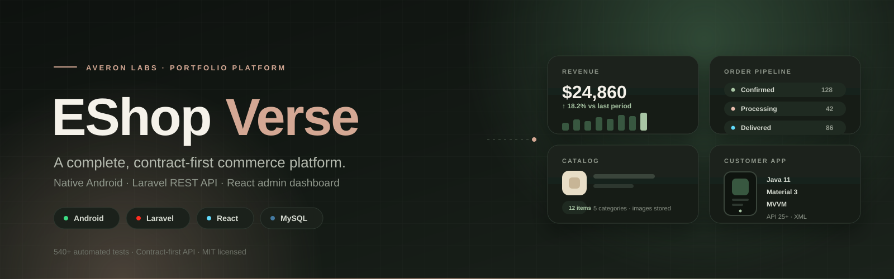
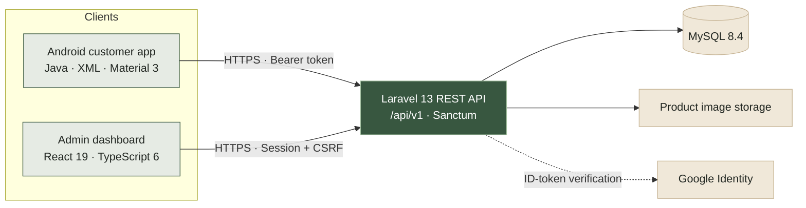

<div align="center">
  
  <br />
  <br />
  <p>
    <a href="https://eshopverse.wasmer.app/login"></a>
    <a href="https://github.com/Averon-Labs/eshop-verse/actions/workflows/ci.yml"></a>
    <a href="LICENSE"></a>
    <a href="CONTRIBUTING.md"></a>
  </p>
  <p>
    
    
    
    
    
    
    
  </p>
  <h3>A production-minded portfolio e-commerce platform — one API, three clients, zero shortcuts.</h3>
  <p><em>Native Android shopping experience · Laravel REST API · React admin dashboard</em></p>
</div>

> [!NOTE]
> **EShop Verse is a portfolio demonstration, not a live commerce service.** Payment is simulated, all data is fictional, and no real card credentials are ever requested, accepted, logged, or stored. See [Security](#security-posture) and [`docs/SECURITY.md`](docs/SECURITY.md) for the demo boundaries.

---

## Table of contents

- [Overview](#overview)
- [Live demo](#live-demo)
- [Feature set](#feature-set)
- [Architecture](#architecture)
- [Tech stack](#tech-stack)
- [Repository layout](#repository-layout)
- [Quick start](#quick-start)
- [Demo data](#demo-data)
- [API at a glance](#api-at-a-glance)
- [Engineering quality](#engineering-quality)
- [Security posture](#security-posture)
- [Performance and accessibility](#performance-and-accessibility)
- [Engineering workflow](#engineering-workflow)
- [Documentation](#documentation)
- [Roadmap and status](#roadmap-and-status)
- [Contributing](#contributing)
- [License](#license)

---

## Overview

**EShop Verse** is a full-stack, single-store commerce platform built as a serious portfolio project rather than a tutorial CRUD app. It pairs a native Android customer application with a Laravel REST API and a React administration dashboard — all three sharing one **contract-first API**, one **design language**, and one **documented engineering workflow**.

The project is deliberately built the way a small production team would build it:

- **Contract-first development.** [`docs/openapi.yaml`](docs/openapi.yaml) is an accepted OpenAPI 3.1 contract and the single integration boundary. Endpoints, clients, and tests follow it — not the other way around.
- **Server-authoritative money.** Prices are fixed-precision decimal strings, totals are computed on the server, checkout quotes are fingerprinted, and orders store immutable line-item and address snapshots.
- **Real security boundaries.** Sanctum bearer tokens for Android, first-party HttpOnly sessions with CSRF for the admin SPA, server-side authorization and ownership checks, rate limiting, and Android Keystore encryption for tokens.
- **Measured quality.** 540+ automated tests across the stack, Android Lint, Laravel Pint, ESLint, TypeScript strict mode, Vitest, PHPUnit, OpenAPI linting, and WCAG 2.2 contrast verification.
- **Documented decisions.** Architecture Decision Records, component roadmaps with stable Task IDs, and independent build → test → debug → retest stages.

The result is a complete English-language shopping journey: browse the catalog, search and filter, manage a cart, check out with a simulated payment, and track orders — plus an admin workspace for products, categories, inventory, orders, and sales reporting.

---

## Live demo

| Surface | URL | Notes |
|---------|-----|-------|
| **Admin dashboard** | <https://eshopverse.wasmer.app/login> | React SPA and Laravel API on the same origin |
| **API health** | <https://eshopverse.wasmer.app/up> | Returns `{"status":"up"}` with `Accept: application/json` |
| **API base** | <https://eshopverse.wasmer.app/api/v1> | The Android app's default backend |
| **Android app** | Build from source | Debug and release builds target the hosted demo API by default |

**Demo customer account** — use it in the Android app:

```text
Email:    demo@example.com
Password: Password123
```

Admin accounts are provisioned by the backend seed. The password is set through `DEMO_ADMIN_PASSWORD` and is intentionally **never committed**; local setup and reviewer instructions are in [`docs/HANDOFF.md`](docs/HANDOFF.md). The public demo is free-hosted and may be rate-limited or temporarily unavailable.

---

## Feature set

### Android customer application

A complete 17-screen purchase journey built with Java, XML, Material 3, MVVM, and the Repository pattern:

- **Discover** — home, explore, search, category browsing, sorting, product details, and a two-column adaptive catalog grid.
- **Buy** — server-priced cart, quantity stepper, shipping address, order review, and an explicitly labelled simulated payment outcome.
- **Track** — order history, immutable order detail snapshots, payment result, and status timeline.
- **Account** — registration, sign-in, Google Sign-In, password reset, profile, and secure sign-out.
- **Trust** — Keystore AES-GCM token encryption, cloud/ADB backup exclusions, logcat redaction, and no card or PII collection.
- **Polish** — text-first immediate rendering, asynchronous Glide images, fixed aspect ratios with zero layout shift, shimmer placeholders, cross-fades, RAM/disk caching, viewport lazy loading, and scroll prefetching.

### Admin dashboard

A responsive React SPA for day-to-day store operations:

- **Catalog** — searchable/filterable products, create and edit forms, category assignment, archive/restore, and confirmed deletion.
- **Media** — multipart product-image upload, preview, ordering, removal, and server-side file cleanup.
- **Inventory** — stock adjustment with nonnegative validation and automatic “Out of stock” presentation.
- **Orders** — search, status/date filters, pagination, immutable snapshots, payment badges, and only the transitions the API allows.
- **Reports** — revenue, paid orders, items sold, average order value, daily revenue chart, top products, and order-status mix with 7/30/90-day and custom ranges.
- **Experience** — persisted light/dark theme with no flash before first paint, 44px accessible toggle, responsive table-to-card layouts, keyboard operation, visible focus, and WCAG 2.2 contrast checks.

### REST API

A Laravel 13 API backed by MySQL 8.4 and documented as an OpenAPI 3.1 contract:

- Customer authentication with Sanctum, Google ID-token verification, and password reset.
- Public catalog reads with categories, product details, pagination, search, and sorting.
- Authenticated cart, checkout quote, idempotent order creation, and simulated payment outcomes.
- Admin session authentication with CSRF rotation, catalog, inventory, order-status, media, and sales-report operations.
- Consistent JSON error envelopes, fixed-precision money, per-class rate limits, and explicit order transition rules.

---

## Architecture



**Component boundaries are enforced, not implied:**

1. The Android app talks to the backend **only** through the REST API.
2. The admin dashboard talks to the backend **only** through the REST API.
3. No component reads another component's database or internal state.
4. The OpenAPI contract is the integration boundary; contract changes are made first and re-accepted.
5. Each component can be built, tested, and deployed independently.

Deeper reading: [`docs/ARCHITECTURE.md`](docs/ARCHITECTURE.md) and [`docs/decisions/`](docs/decisions/).

---

## Tech stack

| Layer | Technologies |
|-------|--------------|
| **Android** | Java 11, XML, Material 3, MVVM, Repository pattern, ViewBinding, AndroidX Navigation, Retrofit 3, OkHttp 5, Glide 4, JUnit 4, Mockito, Espresso · minSdk 25, targetSdk 36, compileSdk 36.1 |
| **Backend** | PHP 8.3+, Laravel 13, Laravel Sanctum 4, MySQL 8.4 (`utf8mb4`), PHPUnit 12, Laravel Pint |
| **Admin** | React 19, TypeScript 6 (strict), Vite 8, Tailwind CSS 4, React Router 7, Vitest 5, React Testing Library, ESLint 10 |
| **API contract** | OpenAPI 3.1, Redocly CLI linting |
| **Design** | Material 3 tokens, botanical green / warm ivory / terracotta palette, self-hosted Lato, WCAG 2.2 |
| **CI/CD** | GitHub Actions: Android build/lint/unit tests, backend MySQL 8.4 tests, Pint, OpenAPI lint |
| **Deployment** | Laravel + SPA on a single HTTPS origin; documented free-host and local workflows |

---

## Repository layout

```text
eshop-verse/
├── android/                 # Native Android customer application (Java/XML)
│   ├── app/src/main/        # Screens, view models, repositories, network, resources
│   ├── app/src/test/        # JUnit/Mockito unit and integration tests
│   └── app/src/androidTest/ # Instrumentation tests
├── backend/                 # Laravel REST API, migrations, seeders, PHPUnit tests
│   ├── app/                 # Controllers, models, services, middleware
│   ├── database/            # Migrations, factories, deterministic seeders
│   └── routes/api.php       # The /api/v1 surface
├── admin/                   # React + TypeScript + Vite admin dashboard
│   ├── src/pages/           # Products, categories, inventory, orders, reports
│   ├── src/components/      # Shared shell, dialogs, panels, theme, navigation
│   └── src/api/             # Typed API clients and error handling
├── deploy/                  # Host release packer and upload instructions
├── docs/                    # Architecture, API, database, design, security, roadmaps
│   ├── decisions/           # Architecture Decision Records (ADRs)
│   ├── assets/              # README artwork
│   └── openapi.yaml         # Accepted OpenAPI 3.1 contract
├── .agents/                 # Build, test, and debug workflow guides
├── .ai/                     # AI workspace: handoffs, plans, project state
├── .github/                 # CI, issue templates, PR template, component instructions
├── AGENTS.md                # Provider-neutral engineering instructions
├── CONTRIBUTING.md          # Contribution quick start
├── GLOSSARY.md              # Shared domain vocabulary
└── LICENSE                  # MIT
```

---

## Quick start

### Prerequisites

| Component | Requirements |
|-----------|--------------|
| **All** | Git |
| **Android** | JDK 17+, Android Studio, Android SDK Platform 36.1, Build Tools 36.0.0 |
| **Backend** | PHP 8.3+ (`curl`, `fileinfo`, `mbstring`, `openssl`, `pdo_mysql`, `mysqli`, `zip`), Composer 2, MySQL 8.x |
| **Admin** | Node.js 20.19+ or 22.12+, npm |

```bash
git clone https://github.com/Averon-Labs/eshop-verse.git
cd eshop-verse
```

### 1 · Backend API

Create two MySQL databases — `eshopverse_dev` for development and `eshopverse_test` for the disposable test suite — then:

```bash
cd backend
composer install
cp .env.example .env          # Windows: Copy-Item .env.example .env
# Fill DB_HOST / DB_PORT / DB_DATABASE / DB_USERNAME / DB_PASSWORD in .env
php artisan key:generate
php artisan migrate:fresh --seed
php artisan serve             # http://127.0.0.1:8000
```

Verify the API:

```bash
curl -H "Accept: application/json" http://127.0.0.1:8000/up
curl http://127.0.0.1:8000/api/v1/products
```

Run the backend checks:

```bash
php artisan test              # PHPUnit against eshopverse_test
vendor/bin/pint --test        # PSR-12 + Laravel style
npx --yes "@redocly/cli@2.62.1" lint ../docs/openapi.yaml
```

> Tests are hard-wired to `eshopverse_test` in `phpunit.xml` and wrapped in transactions. They never touch the development database.

### 2 · Admin dashboard

```bash
cd admin
npm ci
npm run dev                   # http://localhost:5173 (port is pinned)
```

Open the SPA at `http://localhost:5173` with the backend on `http://localhost:8000`. The checked-in defaults already accept that origin. Keep both on `localhost` — do **not** mix `localhost` and `127.0.0.1`, because the `SameSite=Lax` session cookie only travels within one site.

Run the admin checks:

```bash
npm run typecheck             # tsc --noEmit
npm run lint                  # ESLint
npm test                      # Vitest + React Testing Library
npm run check:contrast        # WCAG 2.2 light + dark token pairs
npm run build                 # production build in dist/
```

### 3 · Android application

```bash
cd android
./gradlew assembleDebug
./gradlew installDebug        # with an emulator or device attached
```

> On Windows, use `.\gradlew.bat` instead of `./gradlew`.

Debug and release builds point at the hosted demo API by default. To use a local Laravel backend from an emulator:

```bash
./gradlew installDebug -PapiBaseUrl="http://10.0.2.2:8000/api/v1"
```

Run the Android checks:

```bash
./gradlew testDebugUnitTest
./gradlew lintDebug
```

Full component setup, verified command output, and platform notes live in [`docs/DEVELOPMENT.md`](docs/DEVELOPMENT.md).

---

## Demo data

`php artisan migrate:fresh --seed` builds a fixed, fictional store — no real personal data:

| Seed | Count |
|------|-------|
| Users | 2 (1 customer, 1 administrator) |
| Categories | 5 |
| Products | 12 (10 active) |
| Inventory rows | 12 |

| Role | Sign-in | Password | Notes |
|------|---------|----------|-------|
| **Customer** | `demo@example.com` | `Password123` | Local and hosted demo shopper |
| **Administrator** | `demo-admin@eshopverse.test` | `DEMO_ADMIN_PASSWORD` from `backend/.env`, or a random per-install value | Provisioned by the seed; no self-registration |

Reset the demo store at any time with `php artisan migrate:fresh --seed`. Reviewer walkthroughs for all Android and admin screens are in [`docs/HANDOFF.md`](docs/HANDOFF.md).

---

## API at a glance

- **Local base URL:** `http://127.0.0.1:8000/api/v1`
- **Hosted base URL:** `https://eshopverse.wasmer.app/api/v1`
- **Contract:** [`docs/openapi.yaml`](docs/openapi.yaml) (OpenAPI 3.1, accepted 2026-10-12)
- **Conventions:** [`docs/API_CONTRACT.md`](docs/API_CONTRACT.md)

| Group | Representative endpoints |
|-------|--------------------------|
| **Catalog** | `GET /categories` · `GET /products` · `GET /products/{id}` |
| **Customer auth** | `POST /auth/register` · `POST /auth/login` · `POST /auth/google` · `POST /auth/logout` · `GET/PATCH /auth/profile` · password reset |
| **Cart** | `GET /cart` · `POST /cart/items` · `PATCH/DELETE /cart/items/{productId}` · `DELETE /cart` |
| **Checkout & orders** | `POST /checkout/quote` · `POST /orders` · `GET /orders` · `GET /orders/{id}` · `POST /orders/{id}/payment` |
| **Admin session** | `GET /admin/auth/csrf` · `POST /admin/auth/login` · `GET /admin/auth/session` · `POST /admin/auth/logout` |
| **Admin catalog** | products, categories, archive/restore, image upload/delete, inventory |
| **Admin orders** | `GET /admin/orders` · `GET /admin/orders/{id}` · `POST /admin/orders/{id}/status` |
| **Media** | `GET /media/product-images/{productId}/{filename}` |
| **Reports** | `GET /admin/reports/sales` |

**Contract conventions**

- All money is a fixed-precision USD decimal string with exactly two fraction digits; the server computes every total.
- Order creation requires an `Idempotency-Key`; a successful payment confirms the order and decrements stock transactionally.
- Invalid order transitions return `409 INVALID_TRANSITION`; the admin UI only offers transitions the API currently allows.
- Errors use one JSON envelope with stable machine-readable codes.
- Rate limits are applied per endpoint class (public reads, auth, customer writes, admin writes).

---

## Engineering quality

| Component | Automated checks | Command |
|-----------|------------------|---------|
| **Android** | 250+ JUnit/Mockito tests, Android Lint, debug build | `./gradlew testDebugUnitTest lintDebug assembleDebug` |
| **Backend** | 200+ PHPUnit tests, Laravel Pint, Composer validation/audit, OpenAPI lint | `php artisan test` · `vendor/bin/pint --test` · `composer validate --strict` · `composer audit` |
| **Admin** | 90+ Vitest/RTL tests, TypeScript strict type-check, ESLint, WCAG contrast check, production build | `npm test` · `npm run typecheck` · `npm run lint` · `npm run check:contrast` |
| **CI** | GitHub Actions: repository validation, Android build/lint/tests, backend tests against MySQL 8.4, Pint, OpenAPI lint | [`.github/workflows/ci.yml`](.github/workflows/ci.yml) |

**What the tests protect**

- The full purchase journey, including idempotent order creation and simulated success/failure payments.
- Authorization and object ownership: customers cannot read or mutate another customer's cart, orders, or profile.
- Admin-only access to every management endpoint, including CSRF and session lifecycle behavior.
- Catalog lifecycle rules: archive/restore conflicts, duplicate names, product-with-orders deletion conflicts.
- Android view-model state, navigation, validation, error mapping, token storage, and image pipeline behavior.
- Admin loading, empty, error, retry, and `401` states; responsive tables; theme persistence; report ranges.

---

## Security posture

- **Two authentication models, deliberately separated.** Android uses revocable Sanctum bearer tokens; the admin SPA uses a first-party HttpOnly session cookie plus an echoed `XSRF-TOKEN` header. Auth tokens are never written to browser storage.
- **Tokens at rest.** Android stores credentials with Keystore-backed AES-GCM, excludes them from cloud/ADB backup, and redacts sensitive values from logcat.
- **Server-side enforcement.** Role checks and object-level ownership are validated on every request; client-side checks are never trusted.
- **Input and query safety.** Laravel validation rejects unexpected input; Eloquent/parameterized queries prevent SQL injection; outputs are escaped.
- **Rate limiting and minimal errors.** Authentication, registration, Google sign-in, customer writes, and admin writes have per-class throttles; error responses avoid stack traces and internal paths.
- **Dependency hygiene.** `composer audit`, `composer validate --strict`, npm audit, pinned lockfiles, and reviewed dependency additions.
- **Secrets discipline.** `.env` files are git-ignored; `.env.example` contains placeholders only; no credential is committed or logged.
- **Demo boundaries.** Payment is simulated, card data is never collected, and the project does not claim production readiness.

Read [`docs/SECURITY.md`](docs/SECURITY.md) for requirements and [`docs/SECURITY_REVIEW.md`](docs/SECURITY_REVIEW.md) for the review record.

---

## Performance and accessibility

**Text-first rendering, images second.** Every catalog surface binds titles, prices, discounts, stock, and badges immediately. Images stream independently through Glide with:

- fixed aspect ratios and **zero cumulative layout shift**;
- shimmer/skeleton placeholders instead of blank boxes;
- 200–250 ms hardware-accelerated cross-fades;
- viewport-scoped lazy loading and request cancellation on recycle;
- RAM + disk caching and hardware downsampling;
- proactive prefetching of the next visible items during scroll;
- graceful, on-brand fallbacks for failed images.

**Accessibility is part of the definition of done.**

- WCAG 2.2 contrast checks for all admin light and dark token pairs (34/34 pass).
- Minimum 48dp Android touch targets and a 44px admin theme toggle.
- Semantic labels, visible focus, keyboard operation, and non-color-only status communication.
- Scalable text, persistent form labels, accessible dialogs, and announced loading/error states.
- Material 3 components and shared design tokens instead of one-off styles.

Details: [`docs/DESIGN_SYSTEM.md`](docs/DESIGN_SYSTEM.md) and [`docs/SCREEN_SPECIFICATIONS.md`](docs/SCREEN_SPECIFICATIONS.md).

---

## Engineering workflow

EShop Verse is also a demonstration of **disciplined, AI-assisted software delivery**.

- **Contract first.** The OpenAPI contract is reviewed and accepted before endpoints or clients are implemented. Contract changes follow the same review path.
- **Roadmap driven.** Work is assigned by component roadmap, phase, and step — or by stable Task ID — with lettered acceptance criteria and recorded verification evidence.
- **Three independent roles.** A **Builder** implements and adds tests; a different **Tester** verifies the committed SHA; a third **Debugger** is engaged only after a reproduced failure; then an independent **retest** confirms the fix.
- **Gitflow-lite.** `develop` is the integration branch; each phase has a long-lived `feature/<component>-phase-<N>` branch; steps are focused Conventional Commits; task PRs target `develop`; releases are promoted to `main` only through a reviewed PR.
- **Decisions are recorded.** Architecture changes require an ADR in [`docs/decisions/`](docs/decisions/) with a `PROPOSED` status pending human approval.
- **Human approval gates.** Architectural changes, schema changes, API contract changes, security changes, dependency additions, and CI/CD changes require explicit human approval.

The full conventions — including branch naming, commit scopes, PR rules, testing expectations, and safe-editing rules — are in [`AGENTS.md`](AGENTS.md). The role guides are in [`.agents/workflows/`](.agents/workflows/).

---

## Documentation

| Document | What it covers |
|----------|----------------|
| [`docs/PRODUCT.md`](docs/PRODUCT.md) | Product vision, first-release scope, users, and deferred features |
| [`docs/ARCHITECTURE.md`](docs/ARCHITECTURE.md) | System architecture, component boundaries, and UI/data-loading laws |
| [`docs/API_CONTRACT.md`](docs/API_CONTRACT.md) | API conventions, authentication, errors, and rate limits |
| [`docs/openapi.yaml`](docs/openapi.yaml) | Machine-readable OpenAPI 3.1 contract |
| [`docs/DATABASE.md`](docs/DATABASE.md) | Logical data model and schema decisions |
| [`docs/DESIGN_SYSTEM.md`](docs/DESIGN_SYSTEM.md) | Shared tokens, typography, color, spacing, components, and themes |
| [`docs/SCREEN_SPECIFICATIONS.md`](docs/SCREEN_SPECIFICATIONS.md) | Screen-by-screen Android and admin layouts, states, and interactions |
| [`docs/SECURITY.md`](docs/SECURITY.md) | Security requirements and demo boundaries |
| [`docs/TESTING.md`](docs/TESTING.md) | Risk-based testing strategy and verification levels |
| [`docs/DEVELOPMENT.md`](docs/DEVELOPMENT.md) | Setup, local development, and verified command output |
| [`docs/DEPLOYMENT.md`](docs/DEPLOYMENT.md) | Host layout, build packaging, upload, and rollback |
| [`docs/HANDOFF.md`](docs/HANDOFF.md) | Reviewer setup and screen-by-screen walkthroughs |
| [`docs/DECISIONS.md`](docs/DECISIONS.md) | Architecture Decision Record index |
| [`docs/ROADMAP.md`](docs/ROADMAP.md) | Cross-component gates and final release validation |
| [`docs/ANDROID_ROADMAP.md`](docs/ANDROID_ROADMAP.md) | Android phases, steps, criteria, and status |
| [`docs/BACKEND_ROADMAP.md`](docs/BACKEND_ROADMAP.md) | Backend phases, steps, criteria, and status |
| [`docs/ADMIN_ROADMAP.md`](docs/ADMIN_ROADMAP.md) | Admin phases, steps, criteria, and status |
| [`GLOSSARY.md`](GLOSSARY.md) | Shared domain vocabulary |

---

## Roadmap and status

| Area | Status |
|------|--------|
| **Android customer app** | Feature-complete — all planned roadmap phases delivered, including Google Sign-In, the text-first image pipeline, and navigation stability |
| **Backend API** | Core platform complete — Phases 0–4 delivered; product media and sales reporting recently added and in final verification |
| **Admin dashboard** | Core dashboard complete — Phases 0–3 delivered; product images, deletion, and sales reports recently added and in final verification |
| **Platform** | Final cross-component validation, CI completion, and release hardening in progress |

Work is tracked in the component roadmaps. Cross-component gates and release validation live in [`docs/ROADMAP.md`](docs/ROADMAP.md).

---

## Contributing

Contributions, issues, and review feedback are welcome.

1. Read [`CONTRIBUTING.md`](CONTRIBUTING.md) and [`AGENTS.md`](AGENTS.md).
2. Read the relevant component guide: [`android/AGENTS.md`](android/AGENTS.md), [`backend/AGENTS.md`](backend/AGENTS.md), or [`admin/AGENTS.md`](admin/AGENTS.md).
3. Pick a Task ID from the matching component roadmap, or a cross-component task from [`docs/ROADMAP.md`](docs/ROADMAP.md).
4. Follow the branch, commit, test, and PR conventions — and never merge a PR automatically.

All AI-generated code follows the same review process as human-written code: CI must pass, tests are required, and non-trivial changes need human review.

---

## License

This project is licensed under the **MIT License**. See [`LICENSE`](LICENSE) for details.

The Android app bundles the Lato Regular, Semibold, and Bold font files from the [Google Fonts Lato family](https://github.com/google/fonts/tree/main/ofl/lato), distributed under the **SIL Open Font License 1.1**. The license notice is included at [`android/licenses/Lato-OFL.txt`](android/licenses/Lato-OFL.txt).

<div align="center">
  <br />
  <sub>Built with care by <a href="https://github.com/Averon-Labs">Averon Labs</a> · © 2026 EShop Verse</sub>
</div>
