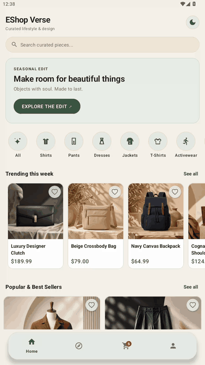
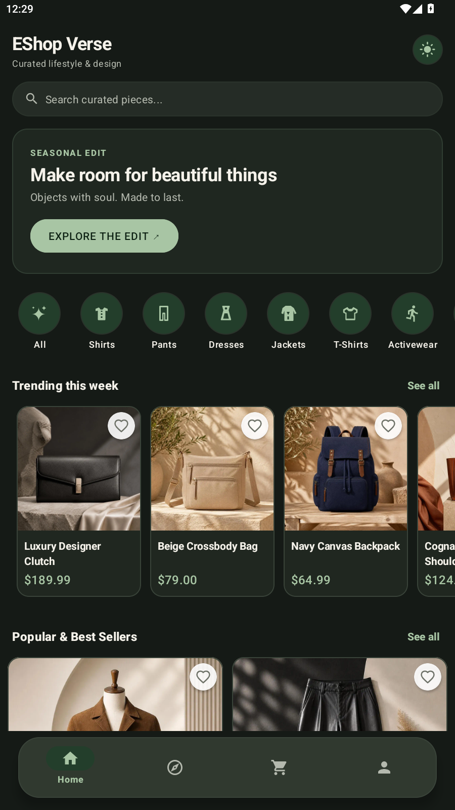
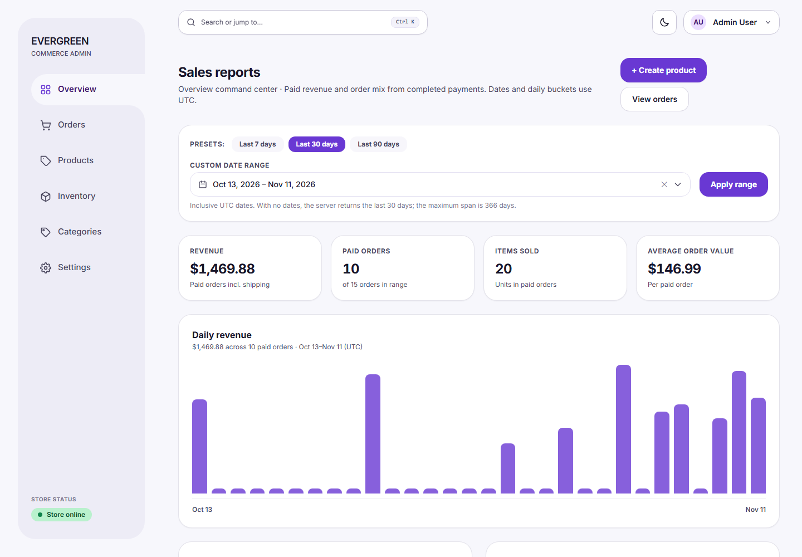
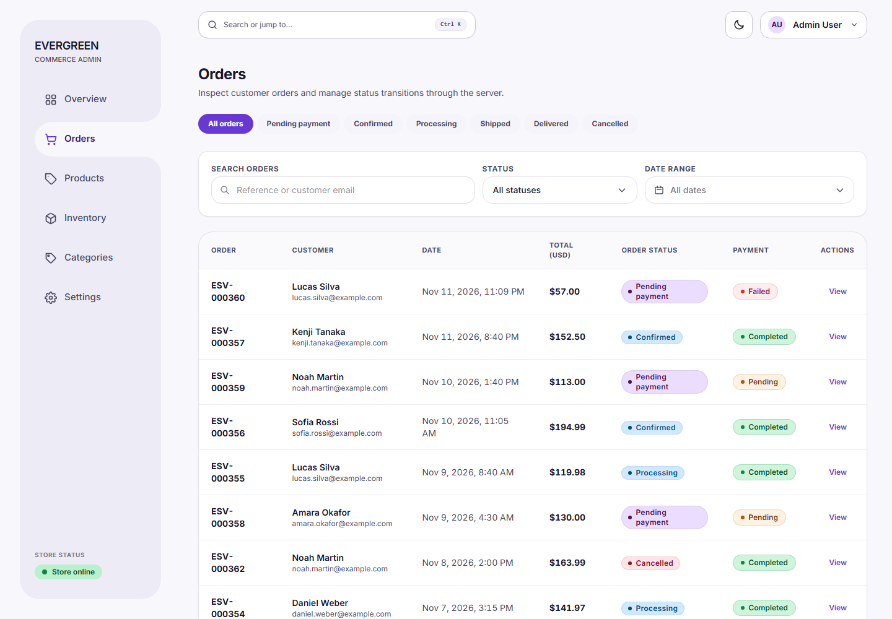
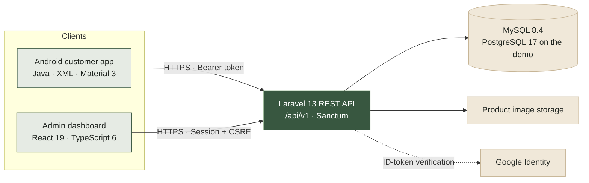

<div align="center">

<h1>EShop Verse</h1>

<p>A full-stack commerce portfolio project — a native Android storefront,<br />
a React admin dashboard, and a Laravel REST API behind one OpenAPI contract.</p>

<br />

<p>
  <a href="https://eshopverse.wasmer.app/login"></a>
  <a href="https://github.com/Averon-Labs/eshop-verse/actions/workflows/ci.yml"></a>
  <a href="LICENSE"></a>
  
  
  
</p>

<p>
  <a href="#quick-start">Quick start</a> ·
  <a href="#architecture">Architecture</a> ·
  <a href="#documentation">Documentation</a>
</p>

</div>

> [!IMPORTANT]
> **EShop Verse is a portfolio demonstration, not a live commerce service.** Checkout and payment are simulated, every customer and order shown here is fictional, and no card credentials are ever requested, accepted, logged, or stored. The public demo is free-hosted and may be rate-limited or temporarily unavailable.
>
> Admin credentials for the public demo are not published in this repository.

---

## Product preview

<p align="center">
  
</p>

<p align="center"><sub>Recorded from the current Android build — catalog → product detail → add to cart → bag.</sub></p>

### Android app

<table>
  <tr>
    <td width="33%"></td>
    <td width="33%"></td>
    <td width="33%"></td>
  </tr>
  <tr>
    <td align="center"><sub><strong>Storefront · light</strong> — catalog, search, and categories</sub></td>
    <td align="center"><sub><strong>Product detail</strong> — imagery, price, stock, and quantity</sub></td>
    <td align="center"><sub><strong>Storefront · dark</strong> — the same flow in the dark theme</sub></td>
  </tr>
</table>

### Admin dashboard

<p align="center">
  
</p>

<p align="center"><sub><strong>Sales report</strong> — revenue, paid orders, items sold, average order value, and daily revenue.</sub></p>

<p align="center">
  
</p>

<p align="center"><sub><strong>Order management</strong> — search, status filters, pagination, and immutable order snapshots.</sub></p>

---

## What it includes

- **Android customer app** — browse, search, and filter the catalog; product details; server-priced cart; address and order review; an explicitly labelled simulated payment; order history with status timelines; account, registration, Google Sign-In, password reset, and a persisted light/dark theme.
- **Admin dashboard** — product and category management, inventory adjustment, order search and status transitions, sales reporting with 7/30/90-day ranges, persisted light/dark theme, and responsive table-to-card layouts.
- **REST API** — Sanctum customer authentication, Google ID-token verification, public catalog reads, cart, checkout quote, idempotent order creation, admin session/CSRF flows, media, and sales reports — all defined in the OpenAPI 3.1 contract.

---

## Architecture



The OpenAPI contract is the only integration boundary. Both clients talk to the API over HTTPS, no component reads another component's database or internal state, and each component is built, tested, and deployed independently.

Deeper reading: [`docs/ARCHITECTURE.md`](docs/ARCHITECTURE.md) and [`docs/decisions/`](docs/decisions/).

---

## Tech stack

| Layer | Technologies |
|-------|--------------|
| **Android** | Java 11, XML, Material 3, MVVM, Repository pattern, ViewBinding, AndroidX Navigation, Retrofit 3, OkHttp 5, Glide 4.16 · minSdk 25, targetSdk 36, compileSdk 36.1 |
| **Admin** | React 19.3, TypeScript 6.0 (strict), Vite 8.3, Tailwind CSS 4.3, React Router 7.18, Vitest 5 |
| **Backend** | PHP 8.3+, Laravel 13, Laravel Sanctum 4.3, PHPUnit 12.5, Laravel Pint |
| **Database** | MySQL 8.4 locally and in CI (`utf8mb4`); the public demo runs on PostgreSQL 17 |
| **API contract** | OpenAPI 3.1, linted with Redocly CLI |
| **Quality / CI** | GitHub Actions: Android build, Android Lint, unit tests, backend PHPUnit against MySQL 8.4, Pint, and OpenAPI lint |

---

## Quick start

**Prerequisites:** Git; JDK 17+ with Android Studio and SDK Platform 36.1 (Android); PHP 8.3+ with Composer 2 and MySQL 8.x (backend); Node.js 20.19+ or 22.12+ (admin).

### 1 · Backend API

Create `eshopverse_dev` and `eshopverse_test` (`utf8mb4`), then:

```bash
cd backend
composer install
cp .env.example .env          # Windows: Copy-Item .env.example .env
# set DB_HOST / DB_PORT / DB_DATABASE / DB_USERNAME / DB_PASSWORD in .env
php artisan key:generate
php artisan migrate:fresh --seed
php artisan serve             # http://127.0.0.1:8000
```

### 2 · Admin dashboard

```bash
cd admin
npm ci
npm run dev                   # http://localhost:5173
```

Keep the API and the SPA on `localhost` — the `SameSite=Lax` session cookie does not cross between `localhost` and `127.0.0.1`.

### 3 · Android application

```bash
cd android
./gradlew installDebug        # with an emulator or device attached
```

Debug and release builds target the hosted demo API by default. For a local backend, use `./gradlew installDebug -PapiBaseUrl="http://10.0.2.2:8000/api/v1"` (Windows: `.\gradlew.bat`).

Full setup, verified command output, and platform notes: [`docs/DEVELOPMENT.md`](docs/DEVELOPMENT.md).

### Demo accounts

| Role | Sign-in | Password | Scope |
|------|---------|----------|-------|
| **Customer** | `aisha.rahman@example.com` | `Password123!` | Public demo |
| **Customer** | `demo@example.com` | `Password123` | Local seed |
| **Administrator** | `demo-admin@eshopverse.test` | `DEMO_ADMIN_PASSWORD` from `backend/.env`, or a random per-install value | Local seed only |

`php artisan migrate:fresh --seed` builds a fixed, fictional store: 2 users, 5 categories, 12 products (10 active), and 12 inventory rows. Reviewer walkthroughs are in [`docs/HANDOFF.md`](docs/HANDOFF.md).

---

## Engineering quality

| Component | Checks |
|-----------|--------|
| **Android** | 258 JUnit/Mockito tests · Android Lint · debug build — `./gradlew testDebugUnitTest lintDebug assembleDebug` |
| **Backend** | 208 PHPUnit tests against MySQL 8.4 · Laravel Pint · OpenAPI lint — `php artisan test` · `vendor/bin/pint --test` |
| **Admin** | 136 Vitest/React Testing Library tests · TypeScript strict type-check · WCAG 2.2 contrast (34/34) · production build — `npm test` · `npm run typecheck` · `npm run check:contrast` · `npm run build` |
| **CI** | GitHub Actions runs repository validation, the Android build/lint/tests, and the backend tests, Pint, and OpenAPI lint on every push — [`.github/workflows/ci.yml`](.github/workflows/ci.yml) |

The suite protects the full purchase journey, including idempotent order creation and simulated success/failure payments; authorization and object ownership across carts, orders, and profiles; admin-only access and CSRF/session lifecycle; catalog archive/restore and deletion conflicts; and Android view-model, token-storage, and image-pipeline behavior.

### Security

- **Two authentication models.** Android uses revocable Sanctum bearer tokens; the admin SPA uses a first-party HttpOnly session cookie with an echoed `XSRF-TOKEN` header. Auth tokens are never written to browser storage.
- **Tokens at rest.** Android stores credentials with Keystore-backed AES-GCM, excludes them from cloud/ADB backup, and redacts sensitive values from logcat.
- **Server-side enforcement.** Role checks and object-level ownership are validated on every request; client-side checks are never trusted. Eloquent/parameterized queries and Laravel validation guard input.
- **Rate limiting and minimal errors.** Authentication, registration, Google sign-in, customer writes, and admin writes have per-class throttles; error responses avoid stack traces and internal paths.
- **Secrets discipline.** `.env` files are git-ignored, `.env.example` contains placeholders only, and `composer audit` plus pinned lockfiles cover dependency hygiene.

Read [`docs/SECURITY.md`](docs/SECURITY.md) and the review record in [`docs/SECURITY_REVIEW.md`](docs/SECURITY_REVIEW.md).

### Performance and accessibility

Catalog surfaces bind titles, prices, stock, and badges immediately; images load asynchronously through Glide with fixed aspect ratios, shimmer placeholders, 200–250 ms cross-fades, viewport-scoped lazy loading, and request cancellation on recycle — so text never waits on a network image and layout does not shift.

Accessibility is part of the definition of done: WCAG 2.2 contrast checks for all 34 admin light/dark token pairs, 48dp Android touch targets, a 44px admin theme toggle, semantic labels, visible focus, keyboard operation, and non-color-only status communication. Details: [`docs/DESIGN_SYSTEM.md`](docs/DESIGN_SYSTEM.md).

---

## Documentation

| Document | What it covers |
|----------|----------------|
| [`docs/PRODUCT.md`](docs/PRODUCT.md) | Product vision, release scope, users, and deferred features |
| [`docs/ARCHITECTURE.md`](docs/ARCHITECTURE.md) | System architecture, component boundaries, and UI/data-loading rules |
| [`docs/API_CONTRACT.md`](docs/API_CONTRACT.md) | API conventions, authentication, errors, and rate limits |
| [`docs/openapi.yaml`](docs/openapi.yaml) | Machine-readable OpenAPI 3.1 contract |
| [`docs/DATABASE.md`](docs/DATABASE.md) | Logical data model and schema decisions |
| [`docs/DESIGN_SYSTEM.md`](docs/DESIGN_SYSTEM.md) | Tokens, typography, color, spacing, components, and themes |
| [`docs/SCREEN_SPECIFICATIONS.md`](docs/SCREEN_SPECIFICATIONS.md) | Screen-by-screen Android and admin layouts and states |
| [`docs/SECURITY.md`](docs/SECURITY.md) | Security requirements and demo boundaries |
| [`docs/TESTING.md`](docs/TESTING.md) | Risk-based testing strategy and verification levels |
| [`docs/DEVELOPMENT.md`](docs/DEVELOPMENT.md) | Setup, local development, and verified command output |
| [`docs/DEPLOYMENT.md`](docs/DEPLOYMENT.md) | Host layout, packaging, upload, and rollback |
| [`docs/HANDOFF.md`](docs/HANDOFF.md) | Reviewer setup and screen-by-screen walkthroughs |
| [`docs/DECISIONS.md`](docs/DECISIONS.md) · [`docs/decisions/`](docs/decisions/) | Architecture Decision Records |
| [`docs/ROADMAP.md`](docs/ROADMAP.md) · [`docs/ANDROID_ROADMAP.md`](docs/ANDROID_ROADMAP.md) · [`docs/BACKEND_ROADMAP.md`](docs/BACKEND_ROADMAP.md) · [`docs/ADMIN_ROADMAP.md`](docs/ADMIN_ROADMAP.md) | Cross-component gates and component-level phases, steps, and status |
| [`GLOSSARY.md`](GLOSSARY.md) | Shared domain vocabulary |

---

## Roadmap and status

| Area | Status |
|------|--------|
| **Android app** | Feature-complete: catalog, cart, checkout, orders, accounts, Google Sign-In, text-first image pipeline, and navigation stability |
| **Backend API** | Core platform complete; product media and sales reporting are in final verification |
| **Admin dashboard** | Catalog, orders, settings, and responsive UI polish complete; product media and sales reporting are in final verification |
| **Platform** | Final cross-component validation and release hardening in progress |

Exact phase and step status lives in the component roadmaps. Cross-component gates are in [`docs/ROADMAP.md`](docs/ROADMAP.md).

---

## Contributing

Contributions, issues, and review feedback are welcome.

1. Read [`CONTRIBUTING.md`](CONTRIBUTING.md) and [`AGENTS.md`](AGENTS.md).
2. Read the component guide: [`android/AGENTS.md`](android/AGENTS.md), [`backend/AGENTS.md`](backend/AGENTS.md), or [`admin/AGENTS.md`](admin/AGENTS.md).
3. Pick a Task ID from the matching component roadmap, or a cross-component task from [`docs/ROADMAP.md`](docs/ROADMAP.md).
4. Follow the branch, commit, test, and PR conventions — and never merge a PR automatically.

All AI-generated code follows the same review process as human-written code: CI must pass, tests are required, and non-trivial changes need human review.

---

## License

This project is licensed under the **MIT License**. See [`LICENSE`](LICENSE) for details.

The Android app bundles the Lato Regular, Semibold, and Bold font files from the [Google Fonts Lato family](https://github.com/google/fonts/tree/main/ofl/lato), distributed under the **SIL Open Font License 1.1**. The license notice is included at [`android/licenses/Lato-OFL.txt`](android/licenses/Lato-OFL.txt).

<div align="center">
  <br />
  <sub>Built with care by <a href="https://github.com/Averon-Labs">Averon Labs</a> · © 2026 EShop Verse</sub>
</div>
